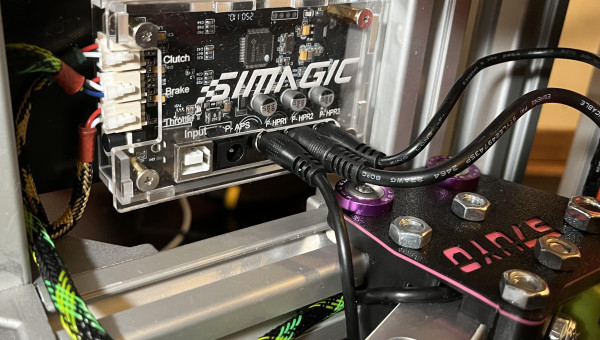
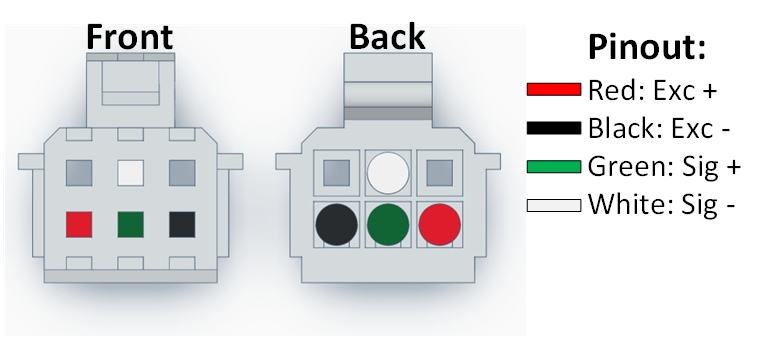
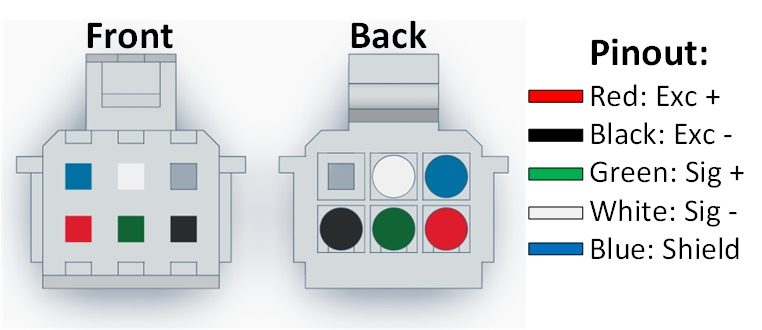
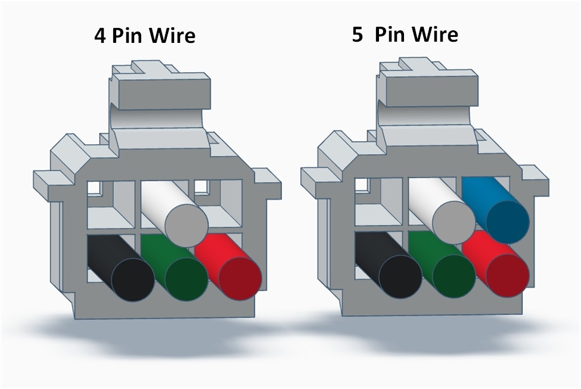
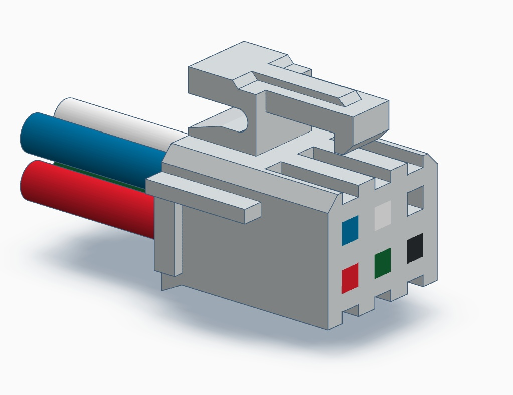
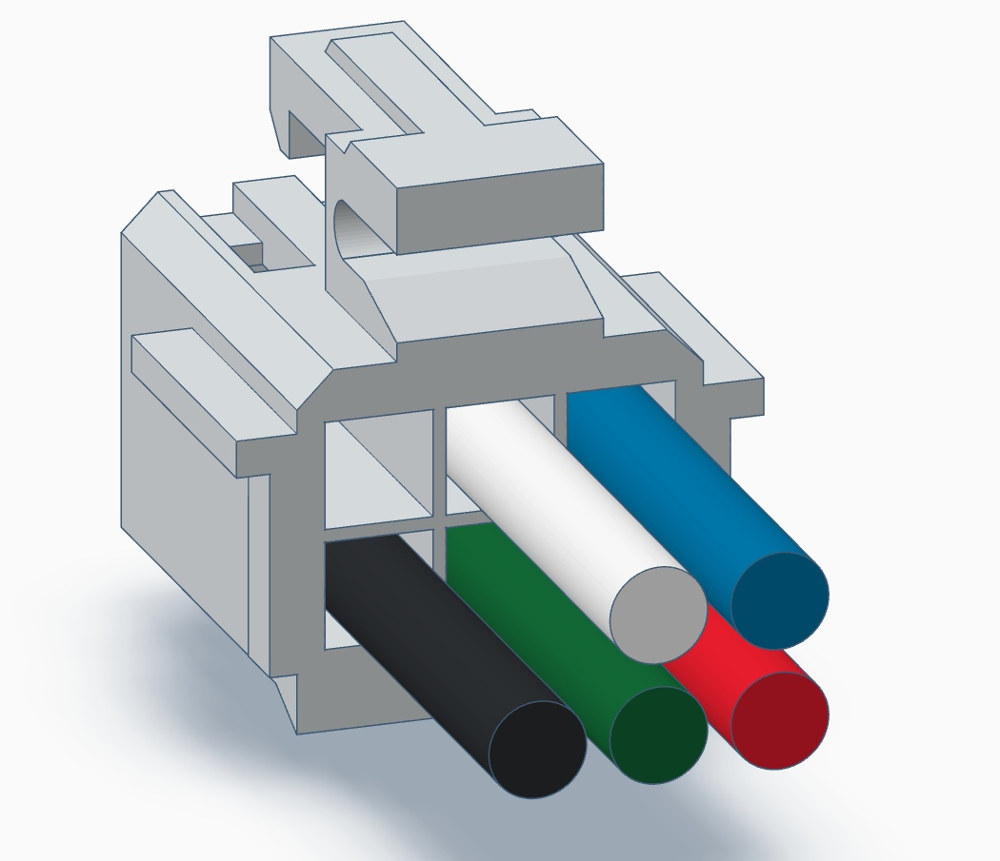
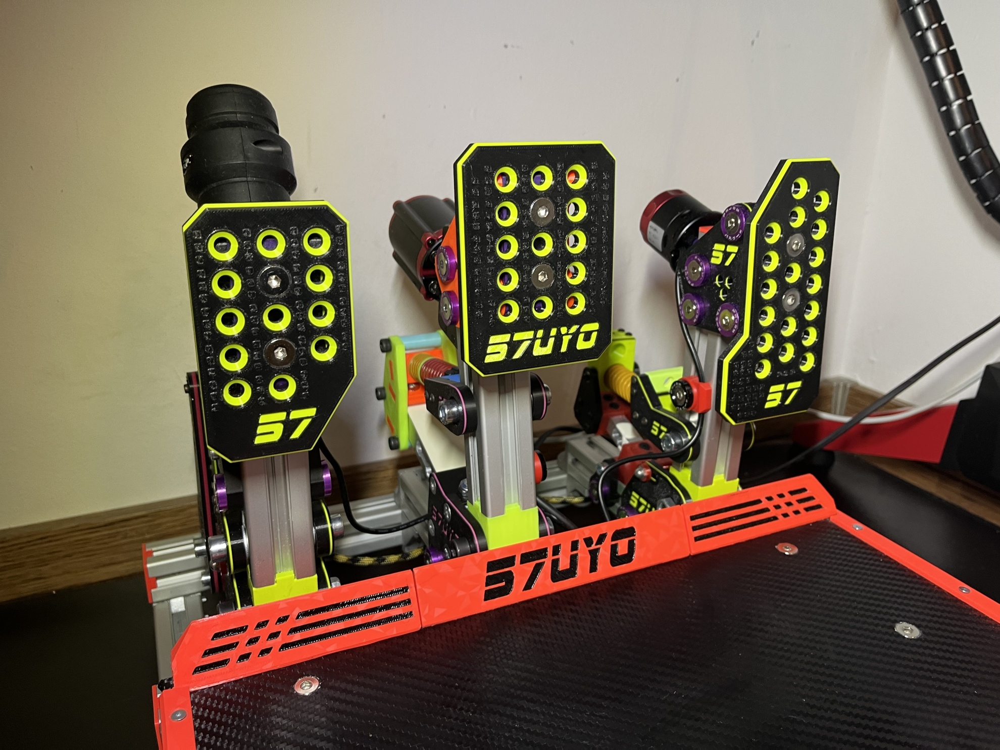
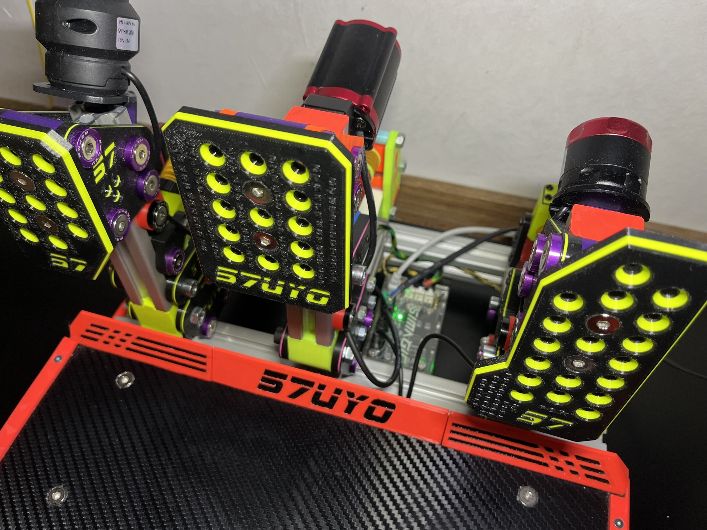
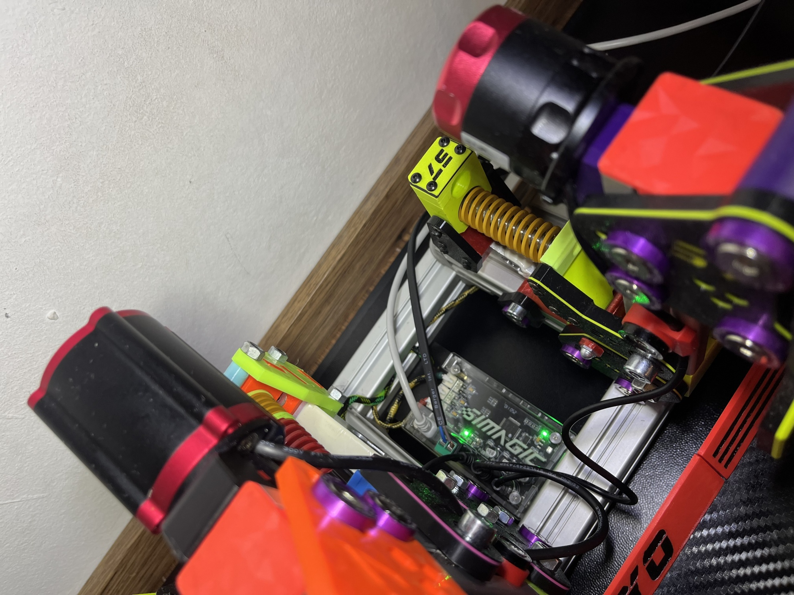

# Universal LC Pedal Controller - Simagic P2000 Control Box

- Author: StuyoADM / DIY-SIM
- Published: 2025-11-06
- Original: [https://www.diy-sim.com/guides/how-to/item/universal-lc-pedal-controller-simagic-p2000-control-box](https://www.diy-sim.com/guides/how-to/item/universal-lc-pedal-controller-simagic-p2000-control-box)
- Retrieved: 2026-10-25
- License: [CC BY-NC 4.0](https://creativecommons.org/licenses/by-nc/4.0/) (site notice, unless otherwise stated).
- Changes: article body converted to Markdown; images saved locally; website navigation, counters, comments UI and unrelated recommendations omitted. Embedded 3D viewer retained as an online link.

DIY Load Cell pedals are great, but there is one big problem - the controller! Never fear - Simagic is here!

A lot of us already bought the Simagic P2000 Haptic Control Box to drive our Reactors, but essentially it is their P2000 Pedal Controller and has input for three Load Cell based pedals. So now, that we already have it, why not connect our Load Cell Pedals to it? This way we will save USBs ports, cables, remove clutter and have less control devices connected. In theory this will work with any Load Cell pedal as LCs are standard component and are supposed to use same color coding, but always they could be discrepancies so make sure you first check if your components are compatible! Again, in theory this would work with other Pedal Control boxes, but we are interested in this particular one because it will drive both pedals and haptic reactors, also is relatively cheap.

## Features

1. Dedicated professional grade pedal controller

2. Relatively cheap

3. Should work with any standard Load Cell

4. Drives both pedals and haptic reactors

5. Works natively in Simagic Control Center

6. Works natively in SimHub

7. Works natively like Simagic device connected to their Wheelbase

8. Less cables, less devices connected in Windows

9. Did I mention relatively cheap?

**Credits**

A user on Reddit did the heavy lifting and figured the 4 cell pinout, so I did not have to do it myself. Original post is here: [Custom Pedals for Simagic Base](https://www.reddit.com/r/Simagic/comments/1efrbpk/comment/lgkuwgt/?utm_source=share&utm_medium=web3x&utm_name=web3xcss&utm_term=1&utm_content=share_button)

**Disclaimer**

It is simple project and in theory as long as you follow the color coding, you should be fine. But on the other hand, you can always burn you controller, load cell or both! We are not accountable for that, mind what you are doing!

## Parts Needed:

1. [P2000 Haptic Control Box](https://simagic.com/products/p2000-haptic-control-box)

2. [JST PHB2.0 PHB 2.0mm 2x6pin connector + lead](https://a.aliexpress.com/_EIrhxFi)

Bonus:

1. [RJ11 Female jack connector with leads 4pin, 6pin (if it fits your original pedals)](https://a.aliexpress.com/_EyQCeN2)

## Pinout:

**N.B.- I have removed the cables from JST connector and rearranged them accordingly to the P2000 pinout to get matching colors. Your connectors will most probably come with different wire arrangement!**

Pictures should be self explanatory, pinout feature standard Load cell color coding:

And what about 5 wired Load Cells? I got you covered - the shield wire should be connected to GND (this pin is connected to the 24V input GND as well):

Just to make sure, here is another perspective:

Some more rotations for the 5 wire setup:

3D model to escape any confusion:

[Interactive 3D model](https://www.tinkercad.com/embed/2jq4iLdzU3v?editbtn=1)

## Example - My DIY Pedals V2 connected to the Simagic P2000 Box

## Conclusion and Future 

My DIY pedals are working great with the P2000 control box. I made sure to use properly sized Load Cells to get good resolution from them with the mechanical construction of the pedals. Throttle and Clutch sense maximum little over their midpoint, so they are pretty sensitive and precise. The brake has 120KG LC, which is a little overkill, but still works like a charm.

The P2000 Brake Pedal uses Load Cell + Hall Sensor. I intend to connect a Hall sensor on my brake and see if it will perform better and how exactly it will work. Presumption is that the only empty pin left is the Hall Sensor Signal.

I will be redoing my other pedals, which have RJ11 4pin jack, to work natively with the P2000 box to investigate how the Simgrade VX-Pro will behave with this controller.
