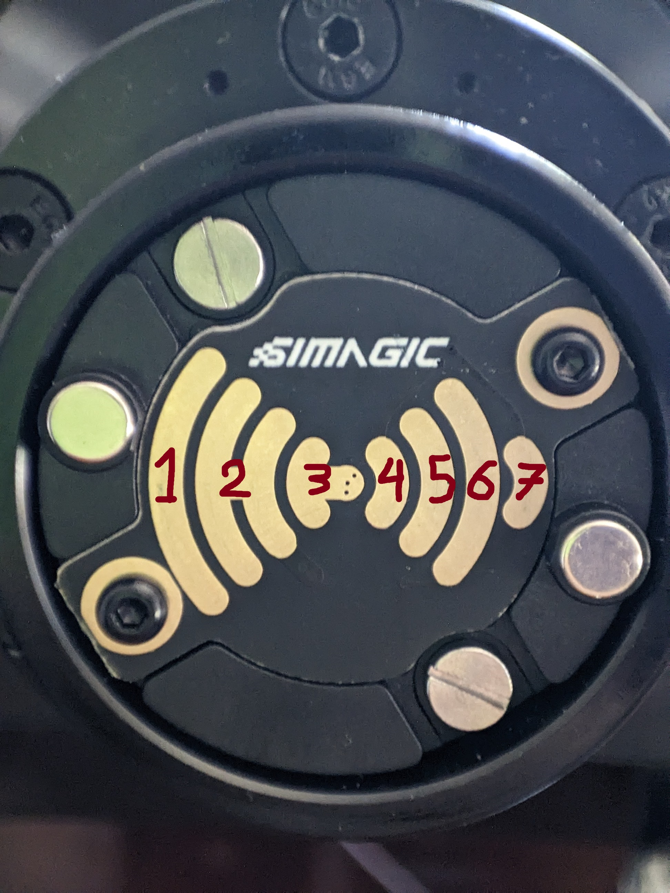
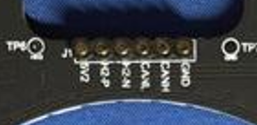
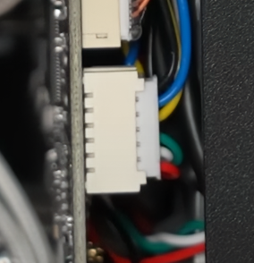
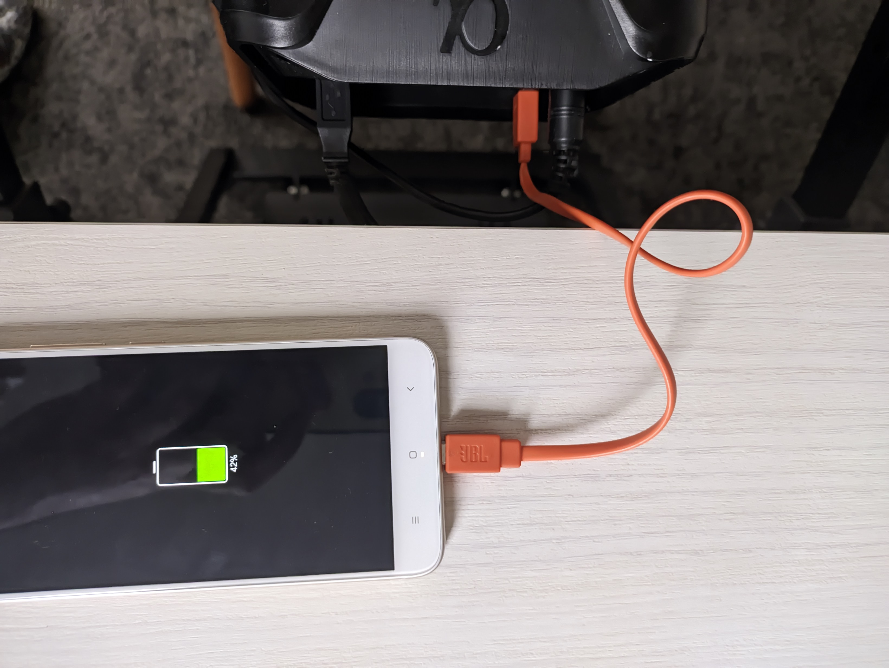
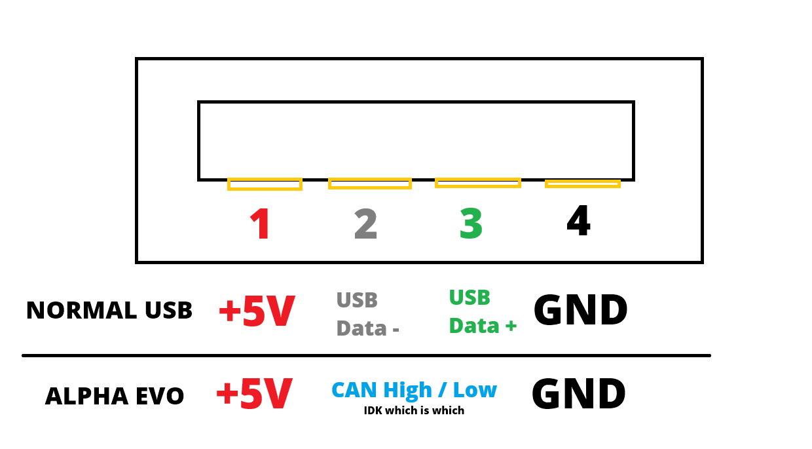
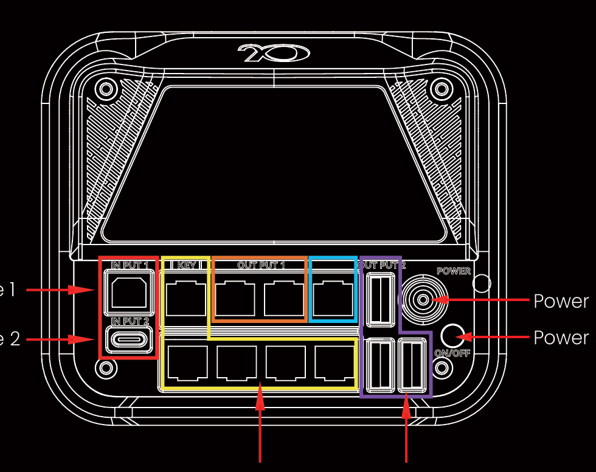
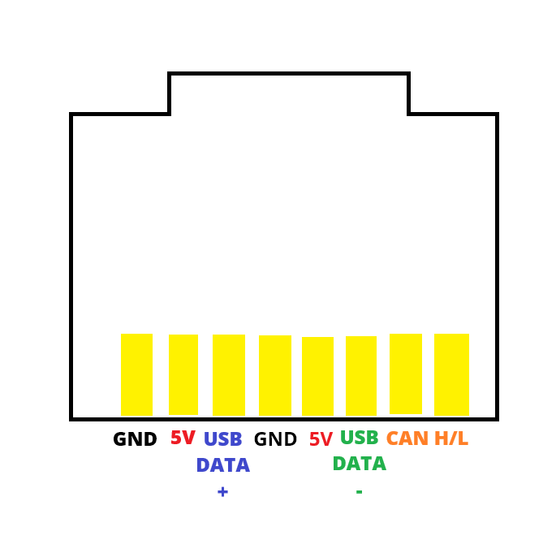
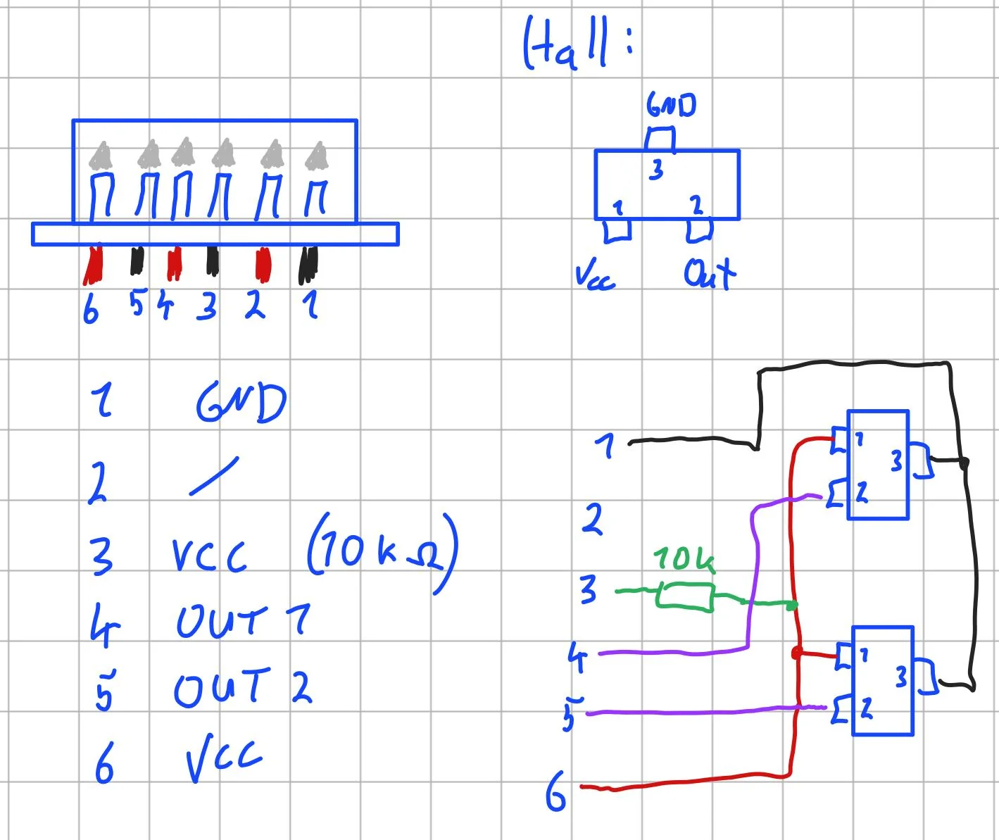
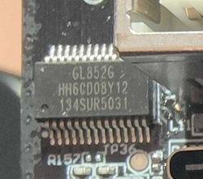

> 原作者：Linx-ESP  
> 原文：[Hardware/Simagic.md](https://github.com/Linx-ESP/Simracing-thoughts-and-docs/blob/main/Hardware/Simagic.md)  
> 翻译所据版本：[f003bf0c9a5d14e2aab1551820480b41df22c000 永久链接](https://github.com/Linx-ESP/Simracing-thoughts-and-docs/blob/f003bf0c9a5d14e2aab1551820480b41df22c000/Hardware/Simagic.md)  
> 翻译日期：2026-10-25  
> 原作及本译文许可：[CC BY-SA 4.0](https://creativecommons.org/licenses/by-sa/4.0/)  
> 本文为非官方简体中文翻译，非 SIMAGIC 官方文档；文中的第一人称指原作者。保留原文的推测、未测试说明及不确定性。

# Alpha EVO 系列

手册：[Simagic](https://cdn.shopify.com/s/files/1/0764/6756/8943/files/SIMAGIC_Alpha_EVO_UM_EN.pdf?v=1750675937)、[archive.org](https://archive.org/details/simagic-alpha-evo-um-en)

- **输出**：
  - USB-B：
    - 方向盘基座
    - CAN/CAN-FD 设备（它们在主机上只显示为一个设备）
  - USB-C：
    - 快拆（QR）直通连接（GT NEO 无需 Maglink）
    - 正面的 6 个触点
    - 两个支持 USB 的 RJ45 接口
    - 内部似乎有一个带供电的集线器（根据能够同时为方向盘和屏幕供电这一点推测）

- **输入**：
  - 电源插头：尺寸待测量，内正极。基座和原配电源均为：48 V / 5.25 A。
    - 译注：原文写作 `48V 5.,25A`，其中 `5.,25A` 疑为排印错误，此处按 5.25 A 整理；该数值未经译者核实。
  - 4× RJ45：CAN-FD 数据
  - 另有 1× RJ45：供紧急停止开关使用的 CAN-FD（似乎不仅能用于急停开关）
  - 2× RJ45：CAN-FD + USB 数据
  - 3× USB-A：CAN（非 FD，无 USB 数据）
  - 正面的 6 个触点：支持 USB

> 译注：以上 RJ45 接口数量按原文保留；原文未明确各项是否包含或重叠，译文未作修正。

## 快拆

**引脚定义**

1. 未使用，未接线。参见 [Fig.11](https://device.report/m/f126831834026bdba767825189e33fd79168db67a7ac37a613d76328ecbc425b)
2. **5V**
3. **GND**
4. USB Data-
5. CAN (-FD?)
6. CAN (-FD?)
7. USB Data+

外部来源：

- https://www.reddit.com/r/Simagic/comments/1lvrenl/alpha_evo_usb_passthrough_pins

- [YouTube：Dan Suzuki — Simagic Alpha EVO 方向盘基座评测](https://youtu.be/pInQ37QII1g?si=CptPgroDBuGtOyhN&t=781)

AliExpress／第三方快拆通常只有 5V 和 GND。如果有完整支持 USB 的款式，用来 DIY 就很棒。

我做了一块 PCB，但尚未测试：https://www.printables.com/model/1393116-simagic-qr-usb-pcb-wheelside

如果你有 Simagic NEO 方向盘，可以用胶带遮住引脚 5 和 6，强制通过直通连接使用 USB；遮住 4、5、6、7 则可强制使用无线连接（与非 EVO 型号的方式相同）。

*他们为什么要在这里加入 CAN？*

**补充**

- 弹簧针：从 PCB 表面起算，压缩时 4.0 mm，伸出时 5.5 mm

- PCB 厚度：1.6 mm

## 正面接口

触点：

- 间距为 2.5 mm 或 2.54 mm。

- 直径为 1.5 mm。

**引脚定义**

图片来源：https://fccid.io/2AWJ8-ALPHA-EVO/Internal-Photos/Internal-photos-7699578.pdf 和 https://device.report/m/f126831834026bdba767825189e33fd79168db67a7ac37a613d76328ecbc425b

从左到右：

- **5V**

- **USB Data+**

- **USB Data-**

- CAN-FD Low

- CAN-FD High

- **GND**

背面 PCB 接线，来源：[Boosted Media](https://www.youtube.com/watch?v=xHefYsMJs54&t=1925s)

## 背面接口

### USB-A

USB-A 接口的 5V 和 GND 与普通 USB 接口相同：

- USB 数据线被替换为 CAN High 和 CAN Low。

- 这些接口可用于供电，使用 USB 线缆／设备似乎没有问题。

- 简单测试显示至少可提供 1 A。当然，仅限 5V。

- 使用 USB 转圆孔电源插头线，可以为 USB 集线器之类的设备供电。

### RJ45

只有上排中间的两个接口（橙色）支持 USB：

- 不支持 USB 的接口与其相同，区别仅在于用于 USB 数据线的两个触点没有连接到任何地方。

**基座端引脚定义**

## 换挡拨片模块

- 引脚定义来源：[r/Simagic](https://www.reddit.com/r/Simagic/comments/1k9zxhn/help_simagic_dual_paddle_shifter/)

# 拆解／拆卸

## FCC 文档

- 多款设备：[device.report](https://device.report/shen-zhen-simagic-technology)
  - 似乎比 fccid.io 更容易浏览，不过应该是相同的文档，至少标记为 FCC 的那些是如此。

## 部分拆解

- GT Neo Hub：[r/Simagic](https://www.reddit.com/r/Simagic/comments/1clidwj/simagic_gt_pro_hub_disassembly/)

- GT Neo：[YouTube：Simagic 官方](https://www.youtube.com/watch?v=_ftnGmK0h7M)

## 所用元器件

### 已确认

- MCU：[GigaDevice GD32E508 VET6](https://www.gigadevice.com/product/mcu/mcus-product-selector/gd32e508vet6)

- 内部 USB 集线器：[GENESYS GL852G](https://www.genesyslogic.com.tw/en/product_view.php?show=22)
  - MTT：妥善的 USB 分流
  - 4 个下行端口：“QR”、“Magnetic Dash”，以及 2 个支持 USB 的 RJ45 接口
  - 图片由 Simagic Discord 用户“carodiohp”提供
   

### 推测

- *Funky Switch*／七向编码器：[ALPS RKJXT1F42001](https://tech.alpsalpine.com/e/products/detail/RKJXT1F42001/)

- RGB 按钮：[CTS 228C 系列](https://eu.mouser.com/datasheet/2/96/CTS_Switches_Tactile_228C_Series_Datasheet-1371171.pdf)
  - 相似型号：HOOYA TC-1196A-RGB-E-01
  - 相似型号：Khon TSL06351-070D831DE-RGB

### 已排除

- 旋转编码器：
  - ALPS EC11 系列：没有带 12 个档位／定位点的型号。
