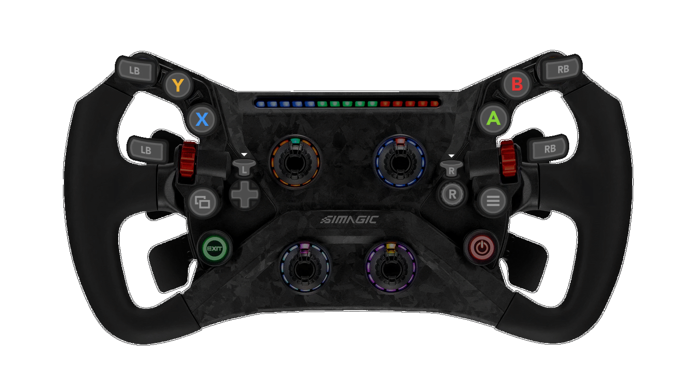

> 原作者：Linx-ESP。本文件为非官方简体中文翻译，翻译日期：2026-10-25。
> [原文](https://github.com/Linx-ESP/Simracing-thoughts-and-docs/blob/f003bf0c9a5d14e2aab1551820480b41df22c000/Software/Playnite/readme.md) · 原文快照：`f003bf0c9a5d14e2aab1551820480b41df22c000`。
> 原作及本译文采用 [知识共享署名—相同方式共享 4.0 国际许可协议（CC BY-SA 4.0）](https://creativecommons.org/licenses/by-sa/4.0/)。

## 将方向盘添加为全屏模式的控制器

补充说明：[Playnite 文档](https://api.playnite.link/docs/manual/gettingStarted/playniteFullscreenMode.html#controller-support)

### 使用我的映射（仅适用于 GT Neo）

- 编辑 `%localappdata%/Playnite/gamecontrollerdb.txt`。

- 添加下面这一行（注意逗号，可能需要删除末尾的逗号，或者在前面补一个逗号）：
  ```
  03003e10703600000508000000000000,GT Neo,a:b7,b:b8,x:b2,y:b1,back:b3,guide:b25,start:b6,leftshoulder:b0,rightshoulder:b9,leftshoulder:b13,rightshoulder:b12,leftstick:b17,rightstick:b25,dpup:b28,dpleft:b24,dpdown:b27,dpright:b29,-leftx:b16,+leftx:b22,-lefty:b21,+lefty:b19,platform:Windows,
  ```



### 创建新的映射

- 使用 [SLD gamepad mapper](https://gitlab.com/ryochan7/sdl2-gamepad-mapper/-/releases)。

## 启动脚本

补充说明：[Playnite 文档](https://api.playnite.link/docs/manual/features/scriptingSupport/exampleScripts.html#starting-additional-applications-before-game-starts-and-killing-it-after-game-exits)

### 通用模拟赛车设置

#### 打开 SimHub

在游戏启动前或启动后执行：
``` pwsh
Start-Process -FilePath "C:\Program Files (x86)\SimHub\SimHubWPF.exe" -WorkingDirectory "C:\Program Files (x86)\SimHub"
```

### 特定游戏设置

#### RaceRoom Racing Experience

打开用于[自定义叠加显示的 dash.exe](https://github.com/sealhud/sealhud.github.io)：

- 游戏启动前或启动后：
  - 如果已经在运行，就不要再次启动，否则将无法正常工作。
  - 将路径修改为你的 `dash.exe` 路径。
``` pwsh
if (!(Get-Process -Name "dash" -EA 0))
{
     Start-Process -FilePath "C:\path\to\dash.exe" -WindowStyle Minimized
}
```

- 退出时：
``` pwsh
Stop-Process -Name "dash"
```
