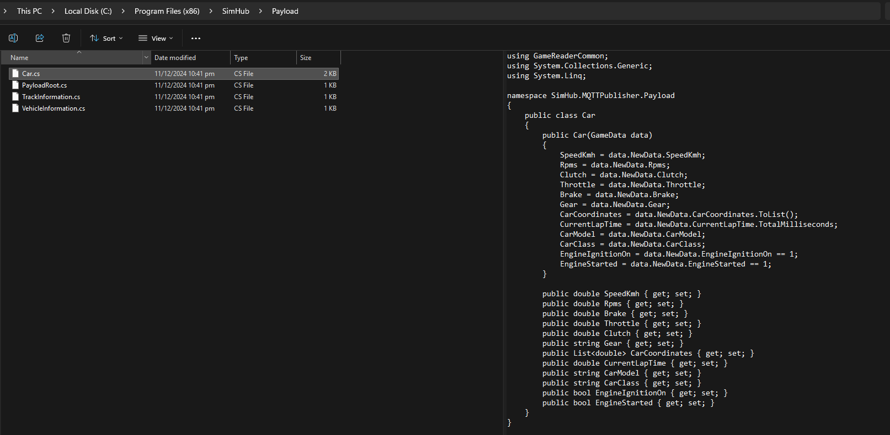

> 原作者：Linx-ESP；MQTT 原文作者：supafly6789。本文件为非官方简体中文翻译，翻译日期：2026-10-25。
> [原文](https://github.com/Linx-ESP/Simracing-thoughts-and-docs/blob/f003bf0c9a5d14e2aab1551820480b41df22c000/Software/SimHub/mqtt.md) · 原文快照：`f003bf0c9a5d14e2aab1551820480b41df22c000`。
> 原作及本译文采用 [知识共享署名—相同方式共享 4.0 国际许可协议（CC BY-SA 4.0）](https://creativecommons.org/licenses/by-sa/4.0/)。

# 转自 SimHub Discord

为适应 GitHub Markdown、提升表述清晰度，并采用[提示框语法](https://docs.github.com/es/get-started/writing-on-github/getting-started-with-writing-and-formatting-on-github/basic-writing-and-formatting-syntax#alerts)，对原文进行了编辑。  
作者：**@supafly6789**，日期：09/10/2025（保留原文日期格式）。[原帖](https://discord.com/channels/299259397060689920/306850631271055362/1425613572960030830)

**MQTT 说明：**

我注意到论坛和 Discord 上有不少 MQTT 问题基本上都没有得到回答，所以想分享一点自己的经验，帮助想要入门的人。
MQTT 是将赛车遥测数据传入 Home Assistant 等平台、用于自动化和显示的绝佳方式。
如果你以前没做过，编译 DLL 可能会让人有点望而却步；对于那些本来已经能熟练在 HA 等平台上折腾 MQTT 的用户来说，这可能也会成为一道入门门槛。

我通过 SimHub 的 MQTT 控制家中和模拟赛车座舱上的各种 LED，并将遥测数据送到显示设备上。
我的配置有这些用法：

- 比赛开始时，房间灯光自动关闭。

- 座舱底部安装了涂鸦（Tuya）WiFi LED 氛围灯，在驾驶场次进行期间调暗。（SimHub 有 Govee 集成，但我想用便宜一点的方案！）

- 上述底部氛围灯的后段在刹车时变红，跑出最快圈时整条灯带闪烁紫光。

- 壁挂平板显示当前车辆、比赛信息和圈速（为此，我将 Assetto Corsa 的车辆图片同步到了 HA 中的一个文件夹）。

**由于 GitHub 上的 MQTT Publisher 项目仅提供源代码，你需要自己编译一次。**

- 下载并解压仓库：https://github.com/SHWotever/SimHub-MQTT-Publisher

- 直接解压到 SimHub 目录（`C:\Program Files (x86)\SimHub`）。

- 安装 Visual Studio Community 2022，并安装 .NET Framework 4.8 SDK 工作负载。

- 在 Visual Studio 中打开 SimHub 文件夹里的 `SimHub.MQTTPublisher.sln`。如果提示需要安装先决条件，请允许安装。

- 在菜单中选择：生成（Build）→ 配置管理器（Configuration Manager）→ Release。

- 生成项目（或按 Ctrl + B）。

- 完成后，将 `C:\Program Files (x86)\SimHub\bin\Release\` 中的以下文件复制回 SimHub 主目录：
  - `SimHub.MQTTPublisher.dll`
  - `MQTTnet.dll`

- 启动 SimHub，接受加载新插件的提示。同时启用对应开关，让插件显示在左侧导航栏中。

> [!IMPORTANT]
> 请注意，如果 SimHub 进行了重大更新，插件可能需要重新编译并导入。遇到这种情况，请重新执行上述步骤，并覆盖 SimHub 目录中的这两个 DLL 文件。

**Home Assistant 专用设置：**

在 SimHub 中配置 MQTT 插件，填入 MQTT 服务器主机名和有效的用户凭据（使用 Mosquito Broker 的 Home Assistant 用户，需要使用已经在 HA 中创建的有效用户。我建议专门为 SimHub 新建一个用户）。
如果愿意，可以修改主题（topic）；我将自己的主题设为 `racing/sim`，如下例所示。
在 HA 中，在 `configuration.yaml` 里配置传感器（如果已经有专用于 MQTT 的 `mqtt.yaml`，也可以在那里配置）。我使用的格式与下面类似：

> 译者注：以下 YAML 代码块按原文原样保留，其中 `name` 行及其相关层级的缩进存在问题，不能将其视为可直接使用的有效配置；本译文未修正代码。

```yaml
mqtt:
  sensor:
    
name: "Sim Speed"
    state_topic: "racing/sim"
    value_template: "{{ value_json.carState.SpeedKmh | float(0) }}"
    unit_of_measurement: "km/h"
    icon: mdi:speedometer
```

继续为其他项目定义传感器。项目文件中的默认 JSON 载荷如下：

```json
{ 
"time": 1759898617695, 
"userId": "xxxx-xxxx-xxxx-xxxx-xxxx", 
"carState": { 
  "SpeedKmh": 0, 
  "Rpms": 4000, 
  "Brake": 100, 
  "Throttle": 0, 
  "Clutch": 100, 
  "Gear": "N",
   "CarCoordinates": [ 614.1373291015625, 5.2156219482421875, 5.778396129608154 ], 
  "CurrentLapTime": 105708, 
  "CarModel": "F1 2023 Red Bull RB19",
   "CarClass": null, 
  "EngineIgnitionOn": true, 
  "EngineStarted": true
   } 
}
```

如果想扩展 MQTT 载荷中的信息，可以在 SimHub 中获取可用属性列表（当然是在 Available Properties 标签页下），然后编辑 MQTT Publisher 项目中 Payload 文件夹内的载荷文件。

如果在这里进行了修改，当然需要重新编译 DLL。


